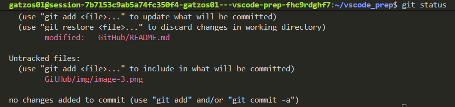
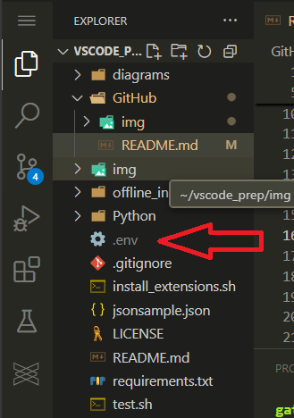
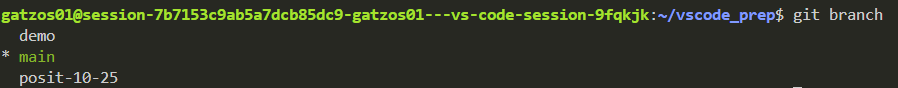
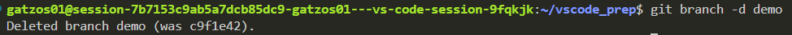
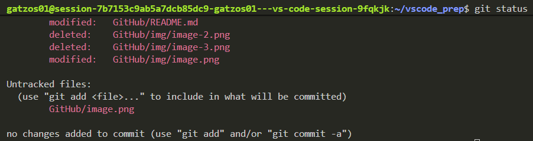

# How to use GitHub on vs code/Positron

There are ways to connect to GitHub. You can use HTTPS or SSH. If a repo is public you can quickly clone a repo using git clone https... but if this repo is not public you will need to setup SSH. If you already setup SSH in R studio you don't need to do it again.

## How to setup SSH by terminal

-   Open a terminal and run the following command: `bash GitHub/setup_github_ssh_min.sh -e "your_email_registed_on_your_github_account" -n -f`
-   The script will print your SSH key. (The key starts with ssh and ends with your email address)
-   Copy the SSH key and add it to the Security section of your GitHub account via the web browser.
-   You can keep multiple SSH keys for different operating systems or computers, but you can delete any keys (GitHub - Security section) that you no longer use.
-   To verify that your SSH key is working, run the following command: `ssh -T git@github.com`
-   You might be asked (in terminal) to contine connecting, just type yes.
-   You should see a message in the terminal similar to: **Hi username! You've successfully authenticated, but GitHub does not provide shell access.**

## Common commands in terminal

If you are working in a project which already is on GitHub. Follow these steps:

-   Open a terminal (if it isn't already open)
-   If you want to check which files have changed, run this command: `git status` 
-   You can add all your changes using this command: `git add .`
-   It's time to create your commit, use this command: `git commit -m "your_message"`
-   Finally, you can push those changes to your repo using, don't forget the branch name: `git push origin branch_name`

Note: Files/folders listed in .gitignore will have a gray colour in your Explorer section and they will stay there no matter which branch you create/move. (.e.g .env file):

## Other important GitHub commands.

-   If you want to create a new branch: `git checkout -b demo`
-   If you want to move to another branch (e.g. back to main):`git checkout main`
-   If you want to list branches you copied in your local folder, the asteric indicates your current branch: `git branch` 
-   If you want to locally delete a branch, don't forget to move to another branch before deletion: `git branch -d demo` 
-   If you want to list changes in the current branch: `git status` 
-   If you want to restore a file, you can use the listed changes from git status command to copy file path. For example I will restore README.md file from GitHub folder: `git restore GitHub/README.md`
- If you want to see the last commit in your local repo: `git log -1`

## If you transfer a repo from your account to an organisation account - It also works when changing from HTTP to SSH

-   Use this command in terminal to check the current url in your local folder: `git remote -v`
-   If you see origin https://github.com... it means it was cloned using HTTPS
-   Copy the URL from the organisation repo
-   Run this command in terminal to set the new orgnaisation github repo: `git remote set-url origin https://github.com/<your_org>/<repo_name>.git`
-   You can see the changes if you run this command again: `git remote -v`

## Git auto completion in Terminal

If you want to add git autocompletion command feature in your terminal you can follow the following steps:

-   Open a terminal using ctrl + alt + ' (if there is no other opened)
-   Run this command to download the feature script: `curl -o ~/.git-completion.bash https://raw.githubusercontent.com/git/git/master/contrib/completion/git-completion.bash`
-   Run this command to Add the feature to your user bash settings: `echo "source ~/.git-completion.bash" >> ~/.bashrc`
-   Run this code to apply the changes: `source ~/.bashrc`
